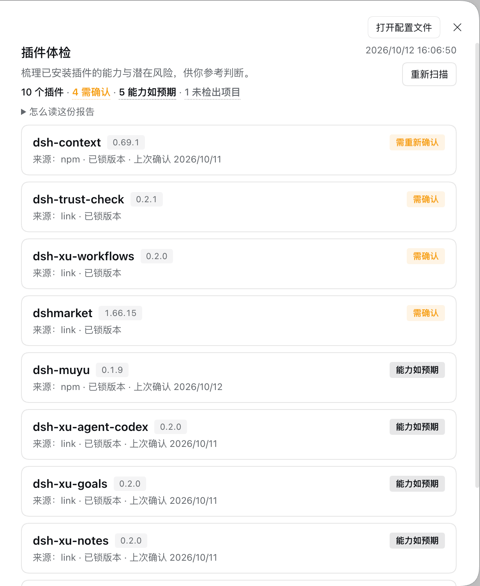
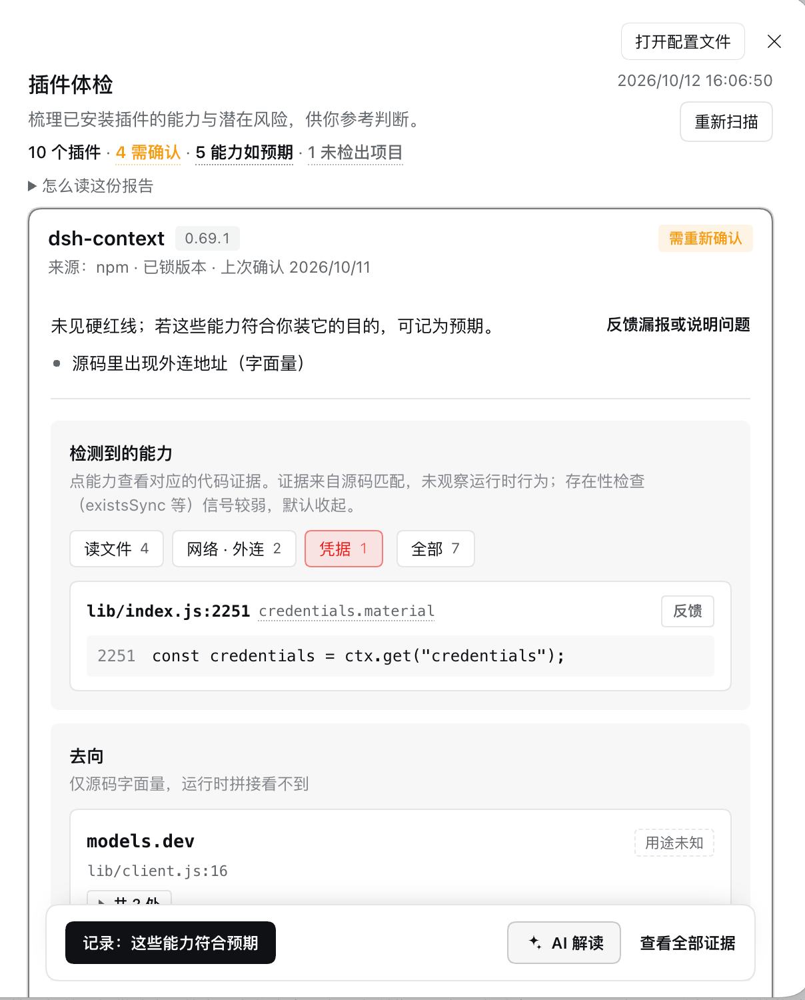
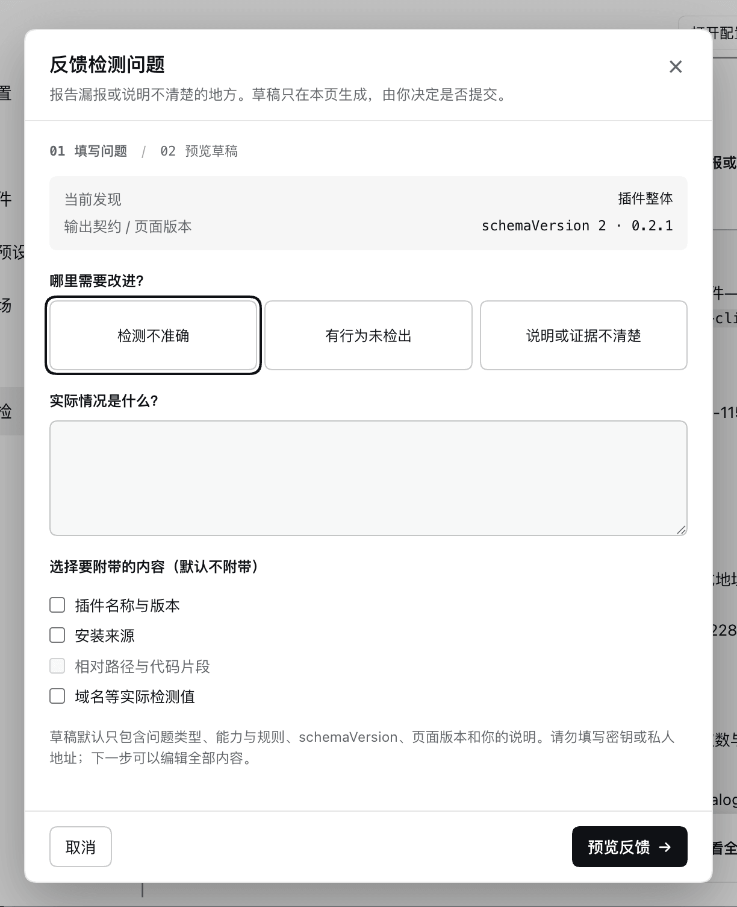
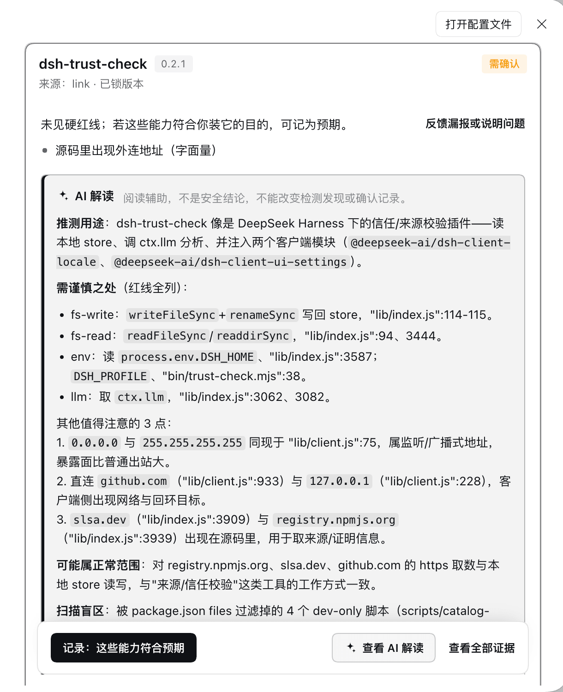
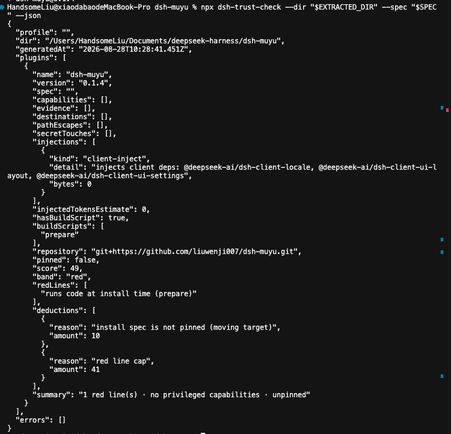

# dsh-trust-check

[](https://awesome-dsh-plugin.com)
[](https://www.npmjs.com/package/dsh-trust-check)
[](https://www.npmjs.com/package/dsh-trust-check)

[中文](README.md) · [English](README.en.md)

Статическое **раскрытие возможностей** плагинов DeepSeek Harness: разрешения, внедрения, источник и установочные скрипты — судит код, воспроизводимо, без токенов.

> Показывает **чего касается плагин, что он внедряет и можно ли проверить его исходники**, и к каждому пункту даёт доказательства (файл + строка + фрагмент), которые вы можете перепроверить. Отчёт сообщает только обнаруженные факты — **это не поручительство безопасности и не вывод о ней**. Блокировать или продолжать, решают интеграторы и пользователи. См. [Позиционирование и границы](docs/POSITIONING.md) (по-китайски).

## Установка

**Настройкам нужен dsh ≥ 0.1.0-rc.8 (рекомендуется 0.1.1-rc.2).** Веб-интерфейс опирается на `@deepseek-ai/dsh-client-store` в таблице модулей хоста. Маркет не заблокирует несовместимую установку; на старом хосте страница настроек не загрузится (`dsh-client-store` нет в таблице модулей).

**CLI не требует хоста DSH** — `npx dsh-trust-check` работает и на старом dsh.

Сначала проверьте хост (это нужно только для настроек):

```sh
dsh --version
# если версия старая: npm i -g @deepseek-ai/dsh@latest
```

```sh
dsh plugin --profile web add dsh-trust-check
```

Перезапустите `dsh web` и откройте **Настройки → Проверка плагинов**. Если плагин уже установлен: обновите его в маркете плагинов либо выполните `dsh plugin --profile web add dsh-trust-check@latest` и перезапустите.

Есть и отдельный CLI, не зависящий от хоста DSH:

```sh
npx dsh-trust-check                 # проверка профиля `web` по умолчанию (сжато; по-китайски без LANG=en*)
npx dsh-trust-check --profile work  # проверка другого профиля
npx dsh-trust-check --verbose       # раскрыть каждый плагин
npx dsh-trust-check --lang en       # отчёт для человека на английском
npx dsh-trust-check --no-color      # отключить ANSI (выключено в конвейере; --color включает на TTY)
npx dsh-trust-check --json          # вывод для машин

# Проверка любого распакованного каталога пакета (без профиля и без DSH)
npx dsh-trust-check --dir ./path/to/plugin
npx dsh-trust-check --dir ./pkg --spec npm:foo@1.0.0 --json

# Ненулевой код выхода для скрипта или шага CI (по желанию)
npx dsh-trust-check --dir ./pkg --exit-code
```

`--dir` и `--profile` взаимоисключающие. Оба режима отдают в `--json` один и тот же `AuditResponse`: `{ schemaVersion, profile, dir?, generatedAt, plugins, errors }`; в режиме одного каталога `profile` — пустая строка, а `dir` — абсолютный путь. См. [docs/audit-schema.md](docs/audit-schema.md) и [docs/INTEGRATION.md](docs/INTEGRATION.md).

По умолчанию код выхода всегда 0. С `--exit-code`: `0` — в этом статическом проходе ничего не найдено (в режиме профиля ещё и подтверждено), `1` — на проверку, `2` — красная линия, `3` — сканирование не удалось; в режиме профиля берётся худший плагин. **Пропуск — не поручительство безопасности.** Ошибки вызова (неизвестный флаг, нет значения у `--dir` и т. п.) печатаются в stderr и дают код `1`.

| Настройки → «Проверка плагинов» | Раскрытая карточка |
| --- | --- |
|  |  |

| Сообщить о проблеме с находкой | Разбор от ИИ |
| --- | --- |
|  |  |

| CLI `--dir --json` |
| --- |
|  |

### Что делать, если не работает

| Если | То |
| --- | --- |
| В настройках: `dsh-client-store` нет в таблице модулей | Хост слишком старый: обновите **dsh ≥ 0.1.0-rc.8**, перезапустите Web; пока проверяйте через CLI выше |
| Пункт «Проверка плагинов» в настройках отсутствует | Убедитесь, что `add` выполнен и хост перезапущен; либо клиент не загрузился на старом хосте |
| Проверка отдаёт 403 за обратным прокси („эта точка входа не разрешена“) | Запустите хост с `--trusted-host <the name in the browser>` (тот же список доверия, что у `/api`). Не выставляйте эту точку входа в открытый интернет без аутентификации. Пока: `npx dsh-trust-check --profile web` или SSH-туннель к `127.0.0.1` |

## Как читать отчёт

Настройки показывают одну колонку карточек, раскрыт может быть только один плагин.

1. **Шапка**: одна строка о назначении и обзор (например, „10 плагинов · 3 на проверку“). Цветные пункты обзора ведут к первой карточке этой группы.
2. **Свёрнутая карточка**: название, версия, метка статуса и источник. Подробности о возможностях появляются после раскрытия.
3. **Раскрытая карточка**: находки и что делать → разбор от ИИ (если создан) → возможности, адреса назначения, пути, секреты, внедрения, источник → доказательства → границы сканирования → панель подтверждения внизу.
4. **Если последнее подтверждение больше не совпадает**: метка показывает «Подтвердить заново», а появившиеся и исчезнувшие возможности — метки `+cap` / `−cap` под названием.
5. **Подтверждение**: внизу карточки; записывает текущий отпечаток в локальное хранилище подтверждений для следующего сканирования.

CLI печатает те же факты по-своему. По умолчанию сжато: важные пункты раскрываются карточками со скруглением (перенос по словам, ширина по терминалу), доказательства под каждым пунктом; для `expected` / `clear` — одна строка. Цвет на TTY, `--no-color` / `NO_COLOR` его отключают. С `--verbose` печатается всё. Машинные интеграции (каталог, CI) должны брать `--json`, а не отчёт для человека.

| Статус | Что значит | Когда |
|---|---|---|
| «С красными линиями» | Обнаружена жёсткая красная линия. Проверьте конкретные факты; риск можно подтвердить и оставить плагин | `redLines` не пуст, текущий отпечаток не подтверждён |
| «С подтверждённым риском» | Вы подтвердили текущий риск красной линии | Есть красные линии, `trust-ack.json` совпадает с этим сканированием |
| «На проверку» | Жёстких красных линий нет, но есть привилегированные возможности или правки patch-файла | Есть возможности либо подмена или отключение, красных линий нет |
| «Подтвердить заново» | Вы подтверждали раньше, но это сканирование уже не совпадает | Подтверждение есть, а отпечаток изменился (обновление, находки или новые правила сканирования) |
| «Как ожидалось» | Вы подтвердили текущий отпечаток возможностей и структуры | `trust-ack.json` совпадает с этим сканированием (красных линий нет) |
| «Без замечаний» | Ни красных линий, ни привилегированных возможностей | Всё остальное |

`score` / `summary` остаются в JSON для сортировки и интеграторов; в настройках их нет. Оценка токенов внедрения видна только как подсказка о затратах в свёртке «Внедрения» (когда она не нулевая).

### Слой структуры (судит код)

Кроме меток возможностей, отчёт достаёт из исходников литеральные факты трёх видов:

- **Литеральные адреса назначения**: URL, хост, IP. HTTP-маршруты того же origin (например, `/dsh-market/check`) адресами не считаются. У каждой строки подписано, как код её использует (аргумент запроса, только сравнение, пространство имён XML, ссылка, присваивание, назначение неизвестно), и указан `file:line`. Подпись нужна для чтения: на возможности, красные линии и баллы она не влияет.
- **Пути за пределами рабочей папки**: абсолютные пути, домашний каталог, обход, …
- **Обращения к секретам**: пути, имена чувствительных переменных окружения.

Они означают, что литерал есть в исходнике; адреса, собранные во время выполнения, не видны (шаблонный URL всё равно сообщает хост, если `${…}` идёт после хоста или сразу за полным хостом с точками, как в `` `https://api.github.com${path}` ``; `${…}` перед хостом скрывает его). Сам литерал не содержит вывода о безопасности.

**Белый список**: обычные домены хостов и реестров (GitHub, npm, npmmirror, зеркала Tencent Cloud, …), отборный каталог DSH и прокси GitHub, а также API популярных поставщиков моделей (DeepSeek, OpenAI, Anthropic, Google Gemini). Строки из белого списка по умолчанию свёрнуты с короткой пометкой; HTTP без шифрования белый список не понижает.

**Отсев шума и ограничение длины**:

- Пропускает строки CIDR-таблиц, выровненные по сети (например, `["10.0.0.0", 8]`, `inRange(a, "10.0.0.0", "10.255.255.255")`); маршруты к хостам вроде `["8.8.8.8", 32]` по-прежнему считаются литеральными IP. Токен `PRIVATE_RANGES` / `CIDR` в строке или два IP в одном вызове строку **не** обнуляют.
- Пропускает документационные диапазоны RFC 5737 (`192.0.2.0/24`, `198.51.100.0/24`, `203.0.113.0/24`) и `0.0.0.0` / `255.255.255.255` (bind и broadcast, не исходящий unicast).
- Пропускает заглушки вроде `http://local` / `http://dsh.invalid`, домены RFC 2606 `.example` / `.invalid` / `.test` и ключи оболочки (`/c`).
- Комментарии вычищаются до сканирования, поэтому пример URL в блоке JSDoc адресом не считается (сборщики обычно эти комментарии сохраняют).
- Идентификаторы пространств имён вроде `xmlns="http://www.w3.org/2000/svg"` и pdf.js `http://www.xfa.org/schema/…` / `http://ns.adobe.com/xdp/` исключаются по точному хосту: зарегистрировать эти домены злоумышленник не может, поэтому льготу не позаимствовать. Подходят только литералы с путём: голый `"http://www.w3.org"` становится другим хостом, как только к нему что-то допишут, поэтому адресом он остаётся.
- Несколько целых URL, которые встроенные библиотеки форматов используют как идентификаторы, а не запросы (DTD Apple plist `http://www.apple.com/DTDs/PropertyList-1.0.dtd`, владелец ID3 `http://musicbrainz.org`), исключаются по **точному литералу**. Любой другой путь или поддомен этих хостов, а также литерал с `+` / `.concat(` после него адресом остаются. Голый `http://musicbrainz.org` освобождён только как операнд `==` / `===` / `!=` / `!==`.
- Когда находок больше предела, остаются самые рискованные: HTTP без шифрования и литеральные IP не вытесняются безобидными адресами.
- Путь к секрету требует **строки только из пути** в кавычках (без пробелов): `"~/.ssh/config"`, `"/Users/x/.ssh/config"`, `'.ssh/config'`, `"~/.aws/credentials"` или путей вроде `/id_rsa` / `~/.netrc`. Текст интерфейса (`"Uses … ~/.ssh/config when empty"`), регулярные выражения запретов, `startsWith('id_rsa')` и голый `'.ssh'` доступом к учётным данным не считаются.

### Отметить как ожидаемое

Когда вы подтверждаете, что возможности совпадают с причиной установки, отпечаток записывается в `trust-ack.json` в каталоге активного профиля (обычно `~/.dsh/profiles/<profile>/`; в DSH Desktop место выбирает хост). Обновление, которое меняет возможности, адреса назначения, выходы за рабочую папку, секреты, красные линии или текст навыка (по хешу содержимого, а не по длине в байтах), требует нового подтверждения.

Запрос подтверждения отправляет `ackFingerprint` из отчёта; при несовпадении возвращается 409 и предложение посмотреть обновлённый отчёт. Старые подтверждения без `digest` больше не совпадают. Принять красную линию по-прежнему можно только отдельным действием «Принимаю риск — продолжить» и только когда отпечаток совпал.

**Разбор от ИИ**: подсказка для чтения, доступна и с панели подтверждения. Объясняет сводку отчёта на модели, настроенной в DSH; без настроенной модели недоступна. Текст сохраняется на этом устройстве — создайте разбор заново, если изменились версия плагина, находки или язык интерфейса.

**Сообщить о проблеме с находкой**: из каждой строки доказательств можно собрать черновик, а в карточке плагина есть отдельный вход для пропуска или непонятного объяснения. Черновик живёт только в памяти страницы. Неточные находки и непонятные объяснения открывают редактор Markdown-issue с вашими заголовком и телом; отправляете его там же. Пропуск открывает закрытую страницу отчёта из SECURITY.md. Публичная issue появляется, если вы отметите её как обычный пробел в правилах без эксплуатируемого обхода.

### Красные линии (по умолчанию блокируют)

1. объявляет скрипты install / postinstall / preinstall (**не** `prepare`: `prepare` выполняется только при упаковке и установке из git — это снижение баллов, а не красная линия);
2. `cordis.patch.yml` подменяет или отключает основной бандл `@deepseek-ai/*` (сопоставление по `id` **или** `name`);
3. **читает** значения учётных данных и секретов (`credentials.resolve` / `read` / `readRecord` / `get*`, включая псевдонимы швов и переименованные деструктуризации; `getPassword` в keytar и keychain, включая `import * as` / `default as`; или путь к секрету в одной строке с чтением файла) **и** имеет доступ к сети — один дескриптор (`const c = ctx.credentials`, `ctx.get('credentials')`) или метаданные (`describe`) дают метку возможности, но не красную линию;
4. `http://` без шифрования на литеральный хост, который не localhost и не приватный IP из RFC 1918, **и** есть доступ к сети;
5. исходящий литеральный IP, который не loopback, не документационный, не bind/broadcast и не приватный из RFC 1918 (`10/8`, `172.16/12`, `192.168/16`) **и** есть доступ к сети. Приватные IP всё равно попадают в адреса назначения с меткой „локальная сеть“: удалённый злоумышленник не получит отправленный туда трафик, поэтому красной линии нет. `169.254/16` (включая эндпоинт метаданных облака) не освобождён и красную линию даёт.

Красные линии ограничивают числовой балл значением 49 (чтобы не выходило „100 + высокий риск“). **Вердикт считается по `redLines`, а не по баллу**: низкий балл (например, 9) может сложиться из shell, сети и незакреплённой версии — тогда показывается «На проверку», а не «С красными линиями». В JSON `band` может остаться `red` (балл ниже 50), но интерфейс и CLI используют `verdict()`; не смешивайте их.

## Что проверяется

- **Возможности** — Читает: области зависимостей `package.json` и статический скан `lib/` / `dist/` (если обоих нет — корень пакета), `bin/`, `scripts/`, `skills/` / `prompts/` и входные файлы `main` / `exports` / `bin` / строковый `browser`; если `files` разбирается точно, файлы только для разработки, которые npm не публикует, не считаются. Судит: shell / чтение файлов / запись файлов / сеть / учётные данные / окружение / субагенты / среда хоста / LLM / динамический код
- **Внедрения** — Читает: `cordis.patch.yml` + `systemPrompt` / `ctx.skills.register` / `system-prompt/assemble` + текст навыка. Судит: кого подменяет или отключает (`id` или `name`) и что внедряет; литералы навыка и системного промпта дают ещё и оценку токенов внедрения (байты / 4) — она видна только как подсказка о затратах в свёртке внедрений, когда не нулевая
- **Источник** — Читает: `repository` из `package.json` (иначе источник установки из git) + спецификацию установки. Судит: закреплена ли версия / закреплён ли коммит
- **Риск обновления** — Читает: установочные скрипты (install/postinstall/preinstall; `prepare` только снижает балл). Судит: объявлены ли скрипты, которые выполнятся при установке

## Для интеграторов (каталоги плагинов, маркеты, CI)

Как подключить проверку перед установкой: **[docs/INTEGRATION.md](docs/INTEGRATION.md)**.  
Контракт полей JSON: **[docs/audit-schema.md](docs/audit-schema.md)** (`schemaVersion`, стабильные поля проверки, договор о формулировках для значений `capabilities` и шаблонов красных линий с предложенным китайским текстом, изменчивые поля).  
Что меняется в релизах: **[CHANGELOG.md](CHANGELOG.md)** в каждом релизе первым делом перечисляет раздел „Влияет на результаты каталога“ — его читают перед поднятием пина.  
Живая интеграция: awesome-dsh-plugin запускает этот инструмент при сборке каталога; адаптер — [`scripts/lib/capabilities.mjs`](https://github.com/awesome-dsh-plugin/awesome-dsh-plugin/blob/main/scripts/lib/capabilities.mjs) (сторонний код, поддержка там же).

Стабильные экспорты для проверки перед установкой и CI-шлюзов:

```ts
import { auditPlugin, collectPlugin, verdict } from 'dsh-trust-check'

const report = auditPlugin(collectPlugin(extractedDir, spec))

// Что значат три состояния (блокировать или спрашивать — решает интегратор):
// verdict(report) === 'red'    → сигнал риска с высокой уверенностью; обычно предлагают блокировать, пользователь может подтвердить
// verdict(report) === 'review' → привилегированные возможности; обычно показывают их список
// verdict(report) === 'clear'  → в этом статическом проходе ничего не найдено (не поручительство безопасности)
```

То же через CLI (маркет может запустить без DSH):

```sh
npx dsh-trust-check --dir "$EXTRACTED_DIR" --spec "$INSTALL_SPEC" --json
```

`--json` разбирайте единообразно: `plugins[0]` для одного `--dir` или весь массив `plugins` в режиме профиля; непустой `errors` значит, что каталог не прочитался, — **это отказ сканирования, а не `clear`**. Пустая или битая распаковка (нет читаемого `package.json` и нет исходников для скана) попадает в `errors` (fail closed).

Верхнеуровневый **`schemaVersion`** сейчас `2`: он растёт при ломающем изменении **формы** или когда поле становится стабильным контрактом, а не когда меняются правила обнаружения. Схема 2 добавляет `facts[]`, чей `id` — стабильный ключ фильтра; ни одно поле схемы 1 не удалено и не переименовано, значения возможностей и шаблоны красных линий не изменились. См. два документа выше; демонстрация Path A в репозитории: `scripts/market-gate-demo.mjs`.

**Вне области этого релиза**: скачивание удалённых tarball (это работа маркета). Порядок: распакуйте во временный каталог, затем `--dir`.

## Принципы

- **Судит код, результат воспроизводим**: решения принимает таблица правил, токенов не тратится.
- **Сообщает о наличии**: говорит „обнаружено X“; пропуск — не вывод о безопасности и не поручительство.
- **Доказательства можно перепроверить**: у каждого срабатывания есть `file:line` и фрагмент кода.
- **Заменяемая таблица швов**: правила обнаружения — таблица данных (`src/core/seams.ts`); при изменениях API DSH правят таблицу, а не движок.

## Известные ограничения

- **Проверка идёт после установки**: режим профиля смотрит **уже установленные** плагины; install, postinstall и prepare могли выполниться до первого скана. `--dir` сканирует распакованное дерево до установки (но установочные скрипты могут выполниться и при распаковке и установке в маркете).
- Статический скан и пропускает, и ошибается: возможности, загруженные во время выполнения, не видны; динамический `import('node:' + …)`, склейка строк и обфусцированные `eval`/`Function` всё ещё обходят таблицу правил.
- **Не разворачивает дерево зависимостей**: обход пропускает `node_modules`, а голый `import 'lodash'` не прослеживается. Относительный путь внутрь `node_modules` этого пакета сканируется.
- **Чтение значений учётных данных покрывает**: сервис швов (`ctx.get('credentials')`, включая `await` / необязательный `get?.`; получатели `ctx` / `this.ctx` / `*Ctx`), доступ к свойству (`ctx.credentials`), деструктуризацию контекста (включая `credentials: creds`), переприсваивание этих псевдонимов (включая `b = a` и `provider = credCtx.credentials ?? null`), чтение пароля в keytar и keychain, включая default / `import * as` / `import { default as … }` / `require`. Голые `readRecord(` / `this.readRecord()` не считаются: это локальные помощники. Цепочки и необязательные цепочки вроде `ctx.get('credentials').readRecord(…)` и `credentials?.resolve(…)` считаются.
- **Пока намеренно пропускается**: деструктуризация до имени функции (`const { resolve } = ctx.credentials`, затем `resolve(…)`) — та же форма, что у исполнителей Promise, и без отслеживания областей видимости это дало бы красную линию таким плагинам, как `dsh-pocket` и `agent-teams`; путь к секрету, спрятанный в переменную, а затем `readFileSync(p)`; получатели, не названные `ctx` или `*Ctx` (например, `context` / `Context`).
- **Базовый аргумент `new URL` не считается адресом**, поэтому у `const u = new URL('/x', 'http://evil'); fetch(u.href)` нет красной линии за HTTP без шифрования — известная цена этого исключения, не расширяйте его.
- Завершённый литерал относительного пути (`fetch('/api')`, `fetch('./x')`) и литерал `blob:` / `data:` — не `network`: первый остаётся тем же origin, второй — это fetch по схеме, в HTTP он не попадает. Экранированный `${` — литеральный текст пути. В шаблоне подстановка после `/` и не-слеша либо после `./` / `../` тоже остаётся тем же origin (`` fetch(`/dsh-xu/${name}`) ``). `` fetch(`/${name}`) ``, `` fetch(`${url}`) ``, аргументы-переменные и конкатенация по-прежнему считаются, как и литерал, который становится `//host` после свёртки `\` / `\n` / `\u` / восьмеричной записи (`\057`). Метка говорит „тот же origin“ или „исходящий“, но отсутствие исходящего литерала не доказывает, что выхода в сеть нет, и балл не меняет.
- Скан режима **`link:` или каталога исходников** отбрасывает файлы, которые npm не публикует, если `files` в `package.json` разбирается точно (файлы, импортированные поставляемым кодом, названные установочным скриптом или объявленные входными, всё равно сканируются). `*` значит любой путь, `dir/*` — весь этот каталог; `src*` не включает файлы внутри `src/`. Фигурные скобки, классы символов, extglob и обратные слэши не фильтруются. Пометка „Браузер / сервер / командная строка / предполагаемая зависимость“ у строки берётся из того, какой вход доводит до файла, и из sourcemap; она нужна для чтения и балл не меняет. Распакованный tarball из реестра и так содержит только опубликованные файлы.
- Токены внедрения — оценка „байты / 4“, а не точный счёт оплаты.
- Установки `link:` / `file:` не дают вывести источник из спецификации; если в package.json нет `repository`, отчёт пишет: «Репозиторий не указан».
- Поле `repository` заполняет сам автор пакета; с именем пакета в npm оно не сверяется, а схема кроме `http(s)` никогда не становится кликабельной ссылкой.

## Разработка

```sh
pnpm install
pnpm build       # tsdown: серверная половина → lib/index.js, клиентская → lib/client.js
pnpm test        # vitest, покрывает движок
pnpm typecheck   # tsc --noEmit
```

Правила, пропуски и белый список принимаются через [CONTRIBUTING.md](CONTRIBUTING.md). **Расширение пропуска или белого списка проверяют строже, чем добавление правила**: и то и другое ослабляет обнаружение, а HTTP без шифрования белый список не понижает. Исправление ложного срабатывания обязано идти с проверкой на fail-open. Классы атак, против которых держат правила, и три ограничения статического анализа — в [THREAT-MODEL.md](THREAT-MODEL.md).

## Планы

- Сейчас: проверка установленных плагинов, CLI `--dir` и веб-отчёт по измерениям; идёт укрепление охвата сканирования
- Интеграции: awesome-dsh-plugin сканирует при сборке каталога; dsh-market и сайт каталога только показывают факты (поддержка там же, заменяемы)
- v2: структурный `facts[]` (`schemaVersion: 2`) с 0.2.0; дальше — сравнение дрейфа между версиями и метаданные реестра от вызывающего кода
- Позже: следить за поднятием пинов каталога и сообщениями о ложных срабатываниях; проверки дрейфа в CI
- Возможно: именованная проверка людьми из сообщества — отдельный репозиторий, привязка к версии, возможность отзыва

Подробно: [docs/POSITIONING.md](docs/POSITIONING.md) (по-китайски).

## Лицензия

MIT
